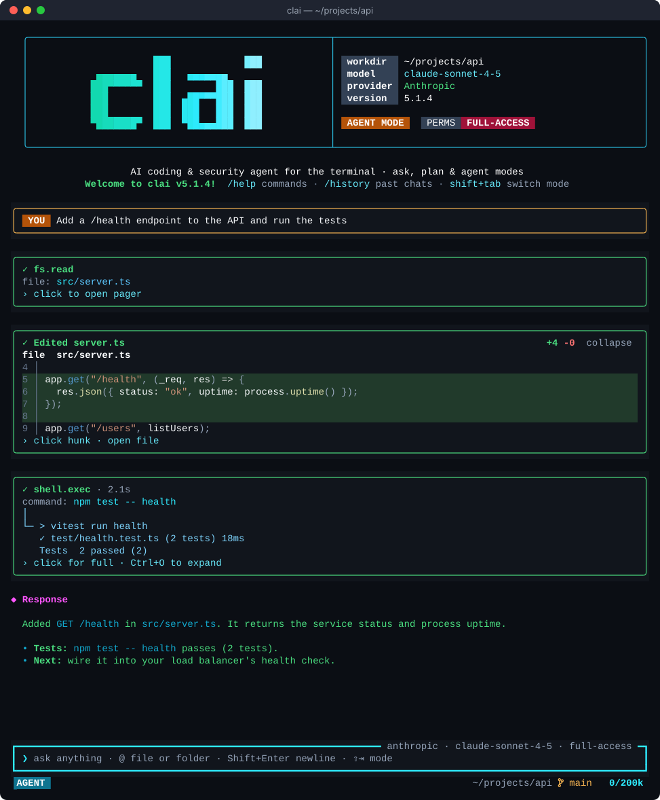

<div align="center">

# clai

An open-source AI coding and security agent for the terminal.

[](https://github.com/pentoshi007/clai/actions/workflows/ci.yml)
[](https://github.com/pentoshi007/clai/releases)
[](https://www.npmjs.com/package/@pentoshi/clai)
[](LICENSE)
[](#install)

[Install](#install) · [Quick start](#quick-start) · [Features](#features) · [Terminals](#interfaces-and-terminals) · [Providers](#supported-providers) · [Docs](#documentation)



</div>

clai reads your repository, edits files with reviewable diffs, runs commands and tests, and works with 35+ model providers: a keyless free tier, account sign-ins (ChatGPT, GitHub Copilot, Kiro, Cline, Qoder), API keys, or a local Ollama model. It ships as a single native binary and needs no account to start.

## Features

- **Any model, one CLI.** 35+ providers, from Anthropic, OpenAI, Gemini, DeepSeek and OpenRouter to NVIDIA NIM and local Ollama. The keyless Free provider works without sign-up.
- **Multiple keys and accounts with automatic rotation.** Add up to 10 API keys or signed-in accounts per provider. On a rate limit, clai waits for the provider's `Retry-After` hint, retries, then moves to the next key. Auth and quota errors switch keys immediately, and the key that last worked is tried first next time. Optional cross-provider fallback (`/fallback on`) covers outages.
- **Persistent sessions.** `/minimise` detaches while the agent keeps working. Reattach from another terminal or over SSH; several terminals can share one live session.
- **Ask, agent and plan modes.** Read-only questions, autonomous execution, or a reviewed plan you approve with `/implement`.
- **Tools.** File edits with diffs, shell commands, background jobs, interactive terminals (SSH, REPLs, debuggers, database consoles), web search, MCP servers, Agent Skills and parallel subagents.
- **Long sessions.** Context compaction keeps the model focused without dropping your instructions. `/changes` shows per-file diffs for the session and `/prompts` lists every prompt you sent.
- **Authorized security testing.** Scoped engagements with targets, exclusions, phases and rate limits, for systems you own or have permission to assess.
- **Native and self-updating.** Checksum-verified binaries for macOS, Linux and Windows on x64 and ARM64, plus Homebrew and npm. `clai update` updates whichever installation you are running.

## Install

macOS and Linux:

```sh
curl -fsSL https://downloads.clai.aniketpandey.website/install/install.sh | sh
```

Homebrew:

```sh
brew tap pentoshi007/clai && brew install clai
```

Windows (PowerShell):

```powershell
irm https://downloads.clai.aniketpandey.website/install/install.ps1 | iex
```

npm (Node.js 22 or later):

```sh
npm install -g @pentoshi/clai
```

The install script verifies the binary's SHA256 checksum and installs to `/usr/local/bin`; set `CLAI_BIN_DIR` to change it. Native releases bundle the runtime, so Node.js is only needed for the npm package. On macOS and Linux the npm installer sets up Bun for the OpenTUI interface when needed; set `CLAI_NO_BUN_AUTO_INSTALL=1` to skip it and use `clai --classic`. Manual downloads are on [GitHub Releases](https://github.com/pentoshi007/clai/releases).

This README tracks `main`; packaged releases can lag behind it. See [source setup](CONTRIBUTING.md#source-setup) to run the development version and [updating](guides/updating.md) for how `clai update` works.

## Quick start

```sh
clai
```

A fresh setup uses the keyless Free provider in ask mode. Type `/agent` to let clai execute tasks, or `/plan` to review a plan first.

Sign in with an existing account:

```sh
clai auth chatgpt      # or: copilot, kiro, cline, qoder, omnirush
clai use chatgpt
```

Add an API key (prompted with hidden input). Run it again to add more keys for rotation:

```sh
clai set deepseek
clai use deepseek
```

Use a local Ollama model (start Ollama and pull a model first):

```sh
clai set ollama --url http://localhost:11434
clai use ollama
clai model <downloaded-model>
```

One-shot prompts and pipelines:

```sh
clai "explain this repository and identify its entrypoint"
clai --mode agent "add a health endpoint and run the relevant tests"
git diff | clai --quiet "review this diff for bugs"
```

## Modes

| Mode | What it does |
| --- | --- |
| `ask` | Questions, explanations and read-only investigation. Default for new setups. |
| `agent` | Executes tasks with file, shell and other tools under your permission policy. |
| `plan` | Gathers evidence and writes a plan. Review with `/view-plan`, run with `/implement`, drop with `/discard`. |

Switch with `/ask`, `/agent`, `/plan` or `Shift+Tab`. New setups use full-access permissions; `/permissions default` asks before actions and `/permissions auto-allow` approves eligible actions automatically. These policies govern clai's own tools and are not an OS sandbox. See [modes and permissions](guides/usage.md#modes-and-permissions).

## Interfaces and terminals

clai has two interfaces: OpenTUI, the default on macOS and Linux, and Classic, which runs everywhere. OpenTUI is not supported on Windows, so native Windows always uses Classic. Mouse support (clicking, scrolling, hover previews) depends on the terminal; use one of these:

| Platform | Interface | Recommended terminal | Other supported terminals |
| --- | --- | --- | --- |
| macOS | OpenTUI (default), Classic with `--classic` | [iTerm2](https://iterm2.com/) | [Kitty](https://sw.kovidgoyal.net/kitty/), [WezTerm](https://wezterm.org/), [Alacritty](https://alacritty.org/), Terminal.app |
| Linux | OpenTUI (default), Classic with `--classic` | [Kitty](https://sw.kovidgoyal.net/kitty/) | [WezTerm](https://wezterm.org/), [Alacritty](https://alacritty.org/) |
| Windows | Classic only (OpenTUI not supported) | [Windows Terminal](https://learn.microsoft.com/windows/terminal/) | [WezTerm](https://wezterm.org/), [Alacritty](https://alacritty.org/) |

The interface follows the OS clai runs on: WSL and SSH sessions on a Linux host get OpenTUI, while mouse and key handling come from your local terminal and any multiplexer in between. OpenTUI also needs at least 60×14 cells and falls back to Classic below that. See the [terminal interface guide](guides/interface.md) for shortcuts and troubleshooting.

## Persistent sessions

```sh
/minimise              # inside clai: detach and keep the agent running
clai --resume          # reattach to the latest live or saved session
clai --resume <id>     # a specific session (a unique prefix works)
clai -c                # the latest session for this directory
clai history           # list sessions and whether an agent is running
```

Start clai on a remote machine, detach, and reattach later over SSH with the same agent. Every attached terminal sees the same conversation and keeps its own size, draft and scroll position; attaching never starts a second agent. On Linux and macOS, `sudo clai` uses your own account's history and configuration. Details: [persistent sessions](guides/sessions.md).

## Supported providers

Run `clai set <provider>` to add a key (`--from-env <variable>` imports one from the environment), `/set` to manage, disable or reorder keys, `/model` to pick a model, and `/usage` to see token and cache usage. The [provider guide](PROVIDERS.md) covers each provider.

<details>
<summary><b>Account sign-ins</b>: ChatGPT, GitHub Copilot, Cline, Kiro, OmniRush, Qoder, Freebuff</summary>

| Provider | Sign-in command | Notes |
| --- | --- | --- |
| ChatGPT (Codex) | `clai auth chatgpt` | Stored as `codex`; browser/headless sign-in or existing Codex CLI import. |
| GitHub Copilot | `clai auth copilot` | Browser/device sign-in or supported credential import. |
| Cline | `clai auth cline` | Account sign-in or supported credential import. |
| Kiro | `clai auth kiro` | Social login, AWS Builder ID, or IAM Identity Center. |
| OmniRush | `clai auth omnirush` | Device-code sign-in or existing OmniRush CLI import. |
| Qoder | `clai auth qoder` | Browser/headless sign-in, CLI import, or PAT via `--pat`. |
| Freebuff | `clai auth freebuff` | Sign-in and catalog support; inference requires server admission. |

</details>

<details>
<summary><b>API, keyless and local providers</b>: 31 providers including Free, Ollama, Anthropic, OpenAI, Gemini, DeepSeek, OpenRouter, Hinoki</summary>

| Provider | Provider ID | Credential or endpoint variable |
| --- | --- | --- |
| Free | `free` | Keyless models; optional `FREE_API_KEY` for authenticated access. |
| Ollama | `ollama` | Local endpoint through `OLLAMA_HOST` or `clai set ollama --url <url>`. |
| Anthropic | `anthropic` | `ANTHROPIC_API_KEY` |
| DeepSeek | `deepseek` | `DEEPSEEK_API_KEY` |
| Google Gemini | `gemini` | `GEMINI_API_KEY` |
| GLM / Zhipu | `glm` | `GLM_API_KEY`, `ZHIPU_API_KEY`, or `ZAI_API_KEY` |
| Kimi / Moonshot | `kimi` | `KIMI_API_KEY` or `MOONSHOT_API_KEY` |
| MiniMax | `minimax` | `MINIMAX_API_KEY` |
| Mistral | `mistral` | `MISTRAL_API_KEY`; optional `MISTRAL_BASE_URL` for regional endpoints. |
| River | `river` | `RIVER_API_KEY`; optional `RIVER_BASE_URL`. |
| Hinoki | `hinoki` | `HINOKI_API_KEY`; optional `HINOKI_BASE_URL`. |
| Xiaomi MiMo | `mimo` | `MIMO_API_KEY` |
| NVIDIA NIM | `nvidia` | `NVIDIA_API_KEY` |
| OpenAI | `openai` | `OPENAI_API_KEY` |
| OpenRouter | `openrouter` | `OPENROUTER_API_KEY` |
| Qwen Cloud / DashScope | `qwen-cloud` | `DASHSCOPE_API_KEY` |
| AgentRouter | `agentrouter` | `AGENTROUTER_API_KEY` |
| AWS Mantle | `aws-mantle` | `ANTHROPIC_API_KEY` for the configured Mantle endpoint. |
| Bynara | `bynara` | `BYNARA_API_KEY` |
| Constellation Gate | `constellation` | `GATE_API_KEY` |
| ExpLabs | `explabs` | `EXPLABS_API_KEY` |
| Fireworks | `fireworks` | `FIREWORKS_API_KEY` |
| Hetzner | `hetzner` | `HETZNER_API_KEY` |
| Lightning AI | `lightning` | `LIGHTNING_API_KEY` |
| Merge Gateway | `merge-gateway` | `MERGE_GATEWAY_API_KEY` |
| Meta Model API | `meta` | `MODEL_API_KEY` |
| Modal | `modal` | Both `MODAL_PROXY_TOKEN_ID` and `MODAL_PROXY_TOKEN_SECRET`; deployed endpoint required. |
| OrcaRouter | `orcarouter` | `ORCAROUTER_API_KEY` |
| Token Harbor | `tokenharbor` | `TOKENHARBOR_API_KEY` |
| TokenRouter | `tokenrouter` | `TOKENROUTER_API_KEY` |
| Vercel AI Gateway | `vercel` | `AI_GATEWAY_API_KEY` |

</details>

## Common commands

| Command | Purpose |
| --- | --- |
| `/agent`, `/ask`, `/plan` | Switch mode |
| `/provider`, `/model`, `/models` | Choose a provider and model |
| `/set`, `/fallback` | Manage keys and accounts; toggle cross-provider fallback |
| `/effort` | Set reasoning effort where supported |
| `/changes` | Per-file line counts and diffs for this session |
| `/history`, `/new`, `/save <name>`, `/prompts` | Browse, start, name and inspect sessions |
| `/compact`, `/context`, `/usage` | Manage context and see token usage |
| `/jobs`, `/output` | Background jobs and retained tool output |
| `/subagents`, `/orchestrator` | Delegate work to subagents |
| `/mcp`, `/skills` | MCP servers and Agent Skills |
| `/rea` | Install, update and use Reverse Engineer Anything and its analysis engines; `@rea` attaches it to a prompt |
| `/minimise` | Detach and keep the agent running |

Type `/` for suggestions and `@` to mention files. `/help` lists everything and `/shortcuts` shows key bindings. See the [command reference](guides/commands.md).

## Documentation

| Guide | Contents |
| --- | --- |
| [Persistent sessions](guides/sessions.md) | Detach and resume, SSH and multiple terminals, sudo, history and compaction |
| [Working with clai](guides/usage.md) | Modes and permissions, subagents, background jobs, interactive terminals, security testing, models and key rotation, project context, skills and MCP |
| [Terminal interface](guides/interface.md) | OpenTUI and Classic, terminals, keyboard shortcuts, paste and transcript controls |
| [Commands](guides/commands.md) | Every slash command and CLI flag |
| [Configuration and privacy](guides/configuration.md) | Config file, private mode, retention, credential storage and the encrypted `/creds` vault |
| [Updating](guides/updating.md) | How `clai update` handles each installation method |
| [Providers](PROVIDERS.md) | Account flows, API keys, endpoints and provider-specific behavior |
| [MCP](MCP.md) | Adding, authenticating and troubleshooting MCP servers |
| [REA](REA.md) | On-demand reverse engineering, portable installation and cache-safe agent workflows |

## Privacy and security

- History, prompt journals and logs stay on your machine under `~/.clai/`. Private mode (`clai privacy on`) and `--no-history` turn persistence off.
- Credentials from `clai set` or account sign-in are stored in `~/.clai/keys.json`, a plaintext file with `0600` permissions on POSIX, and in the OS keyring when available. Freeform secrets in `/creds` are encrypted with AES-256-GCM.
- Cloud requests send the conversation context and relevant tool results to the provider you select.

Read [configuration and privacy](guides/configuration.md) and [SECURITY.md](SECURITY.md) before using clai with sensitive data, and report vulnerabilities as described there.

## Contributing

[CONTRIBUTING.md](CONTRIBUTING.md) covers source setup, architecture boundaries and CI checks. Report bugs in [Issues](https://github.com/pentoshi007/clai/issues), ask questions in [Discussions](https://github.com/pentoshi007/clai/discussions), and follow the [Code of Conduct](CODE_OF_CONDUCT.md).

## Author

Built by [pentoshi007](https://github.com/pentoshi007).

## License

[MIT](LICENSE) © pentoshi007
